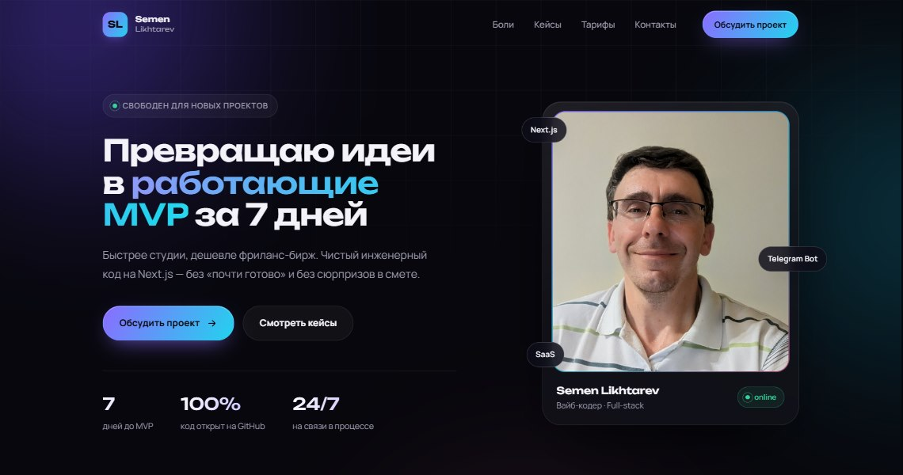

# Сайт-визитка Semen Likhtarev

Одностраничный сайт-визитка вайб-кодера: **превращаю идеи в работающие MVP за 7 дней**. Тёмная тема, градиенты, плавные анимации и современная типографика — без сборки и зависимостей.

[](https://github.com/SemenLiikhtarev/site/actions/workflows/pages.yml)
[](LICENSE)

**Демо:** https://semenliikhtarev.github.io/site/



## Что внутри

- **Hero** — оффер «MVP за 7 дней», CTA «Обсудить проект», фото, статус и плавающие чипы технологий.
- **Боли и решения** — три пары «проблема → ответ»: сроки, Telegram-бот, качество кода.
- **Кейсы** — трекер привычек (SaaS), игровой трекер и лендинг для бьюти-мастера.
- **Тарифы** — сравнение пакетов «База» (MVP под ключ) и «База+» (MVP + поддержка).
- **Контакты** — почта, GitHub как гарантия прозрачности кода, VK.

## Стек

- Чистый **HTML + CSS + JavaScript**, без сборщиков и фреймворков.
- Шрифты **Unbounded** и **Manrope** (Google Fonts) с поддержкой кириллицы.
- Анимации на CSS и `IntersectionObserver`, поддержка `prefers-reduced-motion`.
- Адаптивность: десктоп, планшет, мобильный + бургер-меню.
- Доступность: семантическая разметка, aria-атрибуты, skip-link, видимый фокус.

## Структура

```
.
├── index.html              # страница
├── 404.html                # страница ошибки
├── assets/
│   ├── styles.css          # стили
│   ├── script.js           # меню, reveal-анимации, тилт
│   ├── avatar.jpg          # фото
│   └── preview.jpg         # превью для README и Open Graph
├── .github/workflows/
│   └── pages.yml           # автодеплой на GitHub Pages
├── robots.txt
├── sitemap.xml
├── LICENSE
└── .nojekyll
```

## Локальный запуск

Достаточно открыть `index.html` в браузере. Если нужен локальный сервер:

```bash
npx serve .
```

или

```bash
python -m http.server 4173
```

## Публикация

Репозиторий уже готов к пушу. Осталось создать его на GitHub и отправить код:

```bash
git remote add origin https://github.com/SemenLiikhtarev/site.git
git push -u origin main
```

Затем в репозитории: **Settings → Pages → Build and deployment → Source: GitHub Actions**.

Workflow `.github/workflows/pages.yml` уже лежит в проекте и деплоит сайт при каждом пуше в `main`. Pages включится автоматически при первом запуске (`enablement: true`); если политика репозитория это запрещает — включите источник вручную, как выше. Через минуту после пуша сайт будет доступен по адресу:

```
https://semenliikhtarev.github.io/site/
```

## Контакты

- **Email:** [Lsem2020@gmail.com](mailto:Lsem2020@gmail.com)
- **GitHub:** [@SemenLiikhtarev](https://github.com/SemenLiikhtarev)
- **VK:** [vk.com/id36313731](https://vk.com/id36313731)

## Лицензия

[MIT](LICENSE) © 2026 Semen Likhtarev
